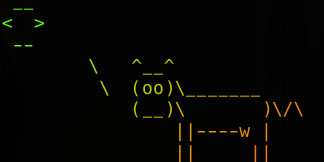

# cowsay-image-to-bluesky


Bot Linux para publicar no Bluesky uma imagem PNG com uma fortuna criada por um LLM (ou, opcionalmente, pelo pipeline clássico `fortune | cowsay | lolcat`).

O script:
- pede ao LLM uma fortuna curta em português europeu através de uma API compatível com OpenAI;
- apresenta a fortuna com `cowsay` e cor com `lolcat`;
- renderiza o ANSI para PNG com fonte monoespaçada;
- faz upload da imagem no Bluesky e publica-a com `embed.images`;
- usa o texto sem ANSI como `alt` da imagem.

## Requisitos

- Linux com `systemd --user`
- Python 3.10+
- `cowsay` e `lolcat` (e `fortune` se for usado o modo clássico)
- dependências Python de `requirements.txt`

Exemplo Debian/Ubuntu:

```bash
sudo apt update
sudo apt install -y fortune cowsay lolcat python3-pip
python3 -m pip install -r requirements.txt
```

## Quickstart

```bash
cp .env.example .env
$EDITOR .env
chmod +x post_cowsay.py install_systemd.sh
./post_cowsay.py
```

Se estiver tudo correto, vai aparecer:

```text
Posted successfully: at://...
```

E o arquivo `last_cowsay.png` ficará salvo localmente para debug.

## Configuração (`.env`)

Obrigatórios:
- `BSKY_IDENTIFIER`: handle ou email da conta Bluesky
- `BSKY_APP_PASSWORD`: app password (não use a password normal)

Fortunas via LLM (configuração por defeito):
- `COWSAY_SOURCE=llm`: usa um modelo para criar uma fortuna nova em pt-PT.
- `LLM_BASE_URL`: URL base da API compatível com OpenAI; por defeito `http://127.0.0.1:11434/v1` (Ollama local).
- `LLM_MODEL`: modelo a usar; por defeito `qwen2.5:3b`.
- `LLM_API_KEY`: chave opcional, necessária apenas em serviços que exijam autenticação.
- `LLM_TIMEOUT`: tempo máximo de espera pela resposta, em segundos (90 por defeito).

Para manter o pipeline antigo, configura `COWSAY_SOURCE=command` e ajusta `COWSAY_GENERATOR`. O script injeta `lolcat -f` se necessário.

Outras opções:
- `BSKY_PDS_HOST`: por padrão `https://bsky.social`
- `BSKY_POST_TEXT`: texto da legenda do post
- `BSKY_FONT_PATH`: caminho de fonte monoespaçada TTF
- `BSKY_FONT_SIZE`: tamanho da fonte no PNG

## Agendamento com systemd timer

Para postar a cada 60 minutos:

```bash
./install_systemd.sh 60
```

Comandos úteis:

```bash
systemctl --user status cowsay-bluesky.timer
systemctl --user list-timers | rg cowsay-bluesky
systemctl --user start cowsay-bluesky.service
journalctl --user -u cowsay-bluesky.service -n 50 --no-pager
```

## Troubleshooting

- Sem cores no PNG:
  - confirme que `lolcat` está instalado;
  - mantenha `COWSAY_GENERATOR` com `lolcat` (o script injeta `-f` automaticamente).
- ASCII distorcido:
  - ajuste `BSKY_FONT_SIZE`;
  - defina `BSKY_FONT_PATH` para uma fonte monoespaçada TTF existente.
- Erro de autenticação Bluesky:
  - gere um novo app password e atualize `BSKY_APP_PASSWORD`.

## Segurança

- `.env` está no `.gitignore` para evitar leak de credenciais.
- Nunca commites a app password do Bluesky nem a chave da API do LLM no repositório.
